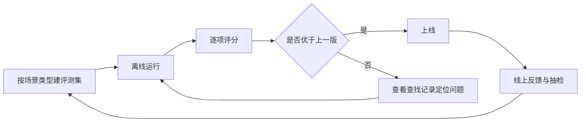

> **当前演示**：单元测试检查预设数据的证据契约；评测集、线上指标和查找记录分析属于设计方案。

「准确优先」要能被衡量，否则只是一句口号。本章说明用什么数据、什么指标来判断一次改动是否让助手更准。

## 怎么设计

1. **按场景类型建评测集**：每类问题都有题目；标准答案包含结论、必须保留的条件和应当引用的条款，由制度负责人审核。
2. **指标有优先级**：答对率 > 条件完整率 > 引用正确率 > 拒答恰当率 > 延迟与成本。
3. **确定性检查随每次回答运行**：引文逐字校验、引用编号存在、只引用采用的证据，每次回答都检查。
4. **记录每次查找过程**：查询词、命中文件、每段分数与理由、补查原因，用来定位错误发生在哪一步。
5. **制度更新触发回归**：文件发布新版本时，重跑引用了这份文件的评测题。

### 指标

| 指标 | 定义 | 作用 |
| --- | --- | --- |
| 答对率（precision） | 给出结论的问题中，结论正确的比例 | 首要指标 |
| 条件完整率 | 标准答案中必须保留的条件，被回答保留下来的比例 | 制度问答特有，漏掉条件就等于答错 |
| 引用正确率 | 引文逐字出自所引段落，且该段支持对应结论 | 前半部分自动检查；后半部分由模型评审，再加人工抽检 |
| 拒答恰当率 | 资料以外的问题被正确拒答，可以回答的问题没有被误拒 | 防止为了提高答对率而过度拒答 |
| 延迟与成本 | 首个进展时间、完成时间的 P50 与 P95，单题成本 | 作为约束，超出上限时再调整 |

## 为什么这样设计

### 1. 按场景类型建评测集

不同类型的问题出错方式不同：条件判断容易漏例外，流程拼接容易漏文件，资料以外的问题容易编造。按类型分层出题，才能看出一次改动改善了哪一类、又伤害了哪一类。标准答案由制度负责人审核，因为是否保留了必要条件，需要业务判断。

### 2. 指标有优先级

只看答对率，系统可以靠大量拒答显得很准；只看答题率，又会鼓励猜测。PaperQA2 同时报告 precision 和 accuracy；本项目在此基础上加入条件完整率，并用拒答恰当率约束答对率。延迟和成本不作为优化目标，但设定上限。

### 3. 确定性检查随每次回答运行

演示中「引文原样出自原文」是一条单元测试；在真实系统中，同样的检查可以在每次回答时执行，几乎没有成本，校验失败的引用直接降级或移除。能用代码判断的，就不交给模型评审。

### 4. 记录每次查找过程

答错的原因可能在检索（没找到）、打分（找到了但被排除）或作答（证据对了但理解错了）。有了每轮的查询词、分数和理由，就能判断该改检索、改阈值，还是改回答要求。界面上展示的查找过程，和这份记录来自同一份数据。

### 5. 制度更新触发回归

制度更新后，原来正确的回答可能变成错误的。按「评测题 → 引用文件」建立索引，文件一更新就重跑相关题目，比定期全量评测更及时。

## 当前演示

当前的测试检查预设数据是否自洽，不衡量真实回答的准确率：

| 检查 | 测试文件 |
| --- | --- |
| 检索命中和候选段落都对应实际资料，分数在 0–10 之间 | `src/lib/research.test.ts` |
| 每处引用都原样出自段落原文 | `src/lib/research.test.ts` |
| 回答只引用通过阈值的证据，引用编号与引用列表一一对应 | `src/lib/research.test.ts` |
| 改签回答经过补查，并保留公务、个人原因和书面确认 | `src/lib/research.test.ts` |
| 个人年假余额、实时会议室和未覆盖的问题不下结论 | `src/lib/research.test.ts` |
| 消息片段顺序、轮次编号、引用标记整体输出、停止后不再输出 | `src/lib/knowledge-adapter.test.ts` |
| 评分行保留相关度、筛选结论和低分理由，并能定位原文 | `src/components/assistant-ui/elements/knowledge-elements.test.tsx` |

## 参考

- [PaperQA2 论文](https://arxiv.org/html/2409.13740v2)（precision 与 accuracy 的定义）
