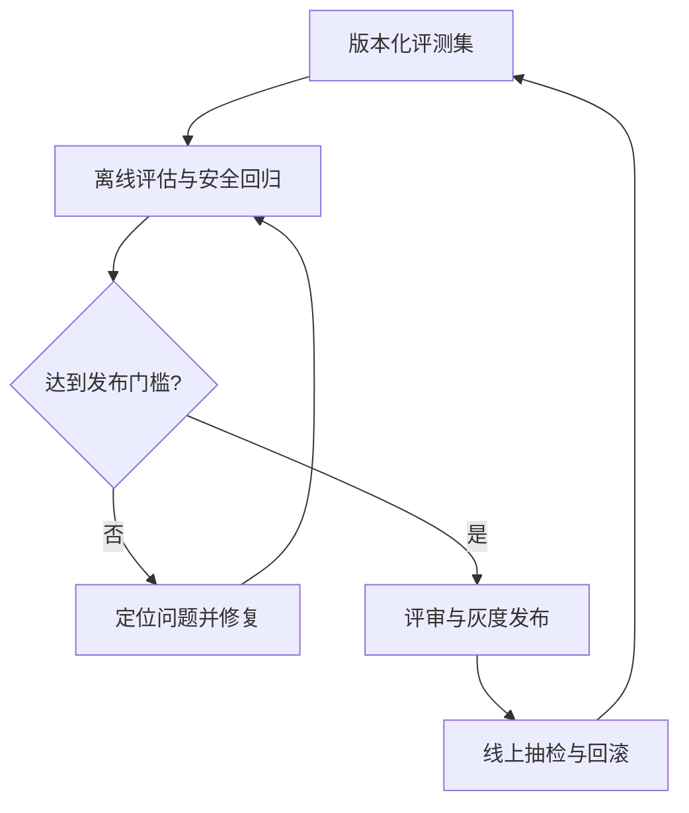

「准确优先」要能被衡量，否则只是一句口号。本章说明用什么数据、什么指标来判断一次改动是否让助手更准。

## 怎么设计

1. **按场景类型建评测集**：每类问题都有题目；标准答案包含结论、必须保留的条件和应当引用的条款，由制度负责人审核。
2. **硬约束与质量指标分开**：先通过权限、来源和重要场景回归，再同时衡量答对率、条件完整率、回答覆盖和拒答情况；平均分提高不抵消严重回归。
3. **确定性检查随每次回答运行**：引文逐字校验、引用编号存在、只引用采用的证据，每次回答都检查。
4. **记录每次查找过程**：查询词、获准的来源 ID、评分、摘要、动作与补查原因，用来定位问题；日志按敏感程度脱敏、授权访问并设置保留期限，不记录完整内部推理。
5. **制度更新触发回归**：文件发布新版本时，重跑引用了这份文件的评测题。

### 指标

| 指标 | 定义 | 作用 |
| --- | --- | --- |
| 答对率（precision） | 给出结论的问题中，结论正确的比例 | 首要指标 |
| 条件完整率 | 标准答案中必须保留的条件，被回答保留下来的比例 | 制度问答特有，漏掉条件就等于答错 |
| 引用定位与支持性 | 分别衡量编号、版本和摘录能否定位，以及原文是否支持对应结论 | 位置检查按确定性规则执行；支持性评估需校准模型评审并由业务人员抽检 |
| 回答覆盖与拒答 | 分别报告给出实质答案的比例、无法回答问题的正确拒答率、可回答问题的误拒答率 | 不用单个混合分数掩盖一律拒答 |
| 延迟与成本 | 首个进展时间、完成时间的 P50 与 P95，单题成本 | 作为约束，超出上限时再调整 |

## 为什么这样设计

### 1. 按场景类型建评测集

不同类型的问题出错方式不同：条件判断容易漏例外，流程拼接容易漏文件，资料以外的问题容易编造。按类型分层出题，才能看出一次改动改善了哪一类、又伤害了哪一类。标准答案由制度负责人审核，因为是否保留了必要条件，需要业务判断。

### 2. 硬约束与质量指标分开

只看答对率，系统可以靠大量拒答显得很准；只看答题率，又会鼓励猜测。PaperQA2 同时报告 precision 和 accuracy；本项目在此基础上加入条件完整率，并用拒答恰当率约束答对率。延迟和成本不作为优化目标，但设定上限。

### 3. 确定性检查随每次回答运行

「引文原样出自原文」可以通过逐字匹配来判断，每次回答都应执行；校验失败时区分位置失配与证据无效：前者在来源仍有效时允许标明段落级定位，后者必须重新取证或修正相关断言。能用确定性规则判断的，就不依赖模型评审。

### 4. 记录每次查找过程

答错的原因可能在检索（没找到）、打分（找到了但被排除）或作答（证据对了但理解错了）。有了每轮的查询词、分数和理由，就能判断该改检索、改阈值，还是改回答要求。界面与日志可以使用同一份结构化事件，但权限、脱敏和展示范围必须分别控制，不能把内部记录原样公开。

### 5. 制度更新触发回归

制度更新后，原来正确的回答可能变成错误的。按「评测题 → 引用文件」建立索引，文件一更新就重跑相关题目，能及时检查直接影响；还要覆盖依赖它的跨文件问题和一组全局回归，避免遗漏间接影响。

## 参考

- [PaperQA2 论文](https://arxiv.org/html/2409.13740v2)（precision 与 accuracy 的定义）
