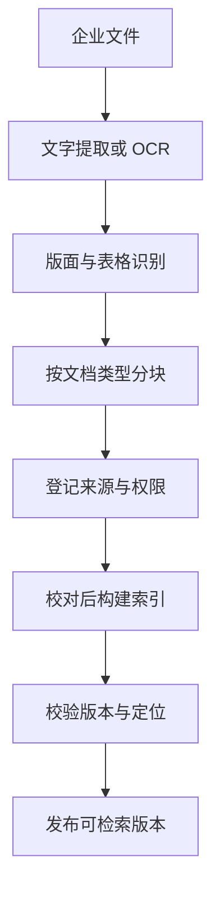

检索与回答的上限由入库决定。一份 PDF 要先变成可定位、可检索、可核对的段落，并带上版本、生效状态和访问范围，后面的每一层才有依据可用。

## 怎么设计

1. **按文档类型分块**：以「章 › 节 › 条」等结构边界为起点，结合长度限制切分；过长条款保留父级上下文，跨条引用和表格表头随片段一起关联，避免丢失条件。
2. **每块登记元数据**：来源标识、版本、有效时间区间、负责部门、文件层级、访问范围、原文位置和标题路径；未知字段标为待确认。
3. **分块后补充检索上下文**：在建索引前为片段关联标题路径和来源说明，例如「《差旅管理办法》第四章 · 第十二条 公务改签」。
4. **维护人员校对解析结果**：入库后可以查看和修正分块，重点检查扫描件、跨页表格和被拆开的条款。
5. **登记文件之间的引用**：识别「以相关制度为准」「按《××》执行」等表述，建立文件之间的链接。
6. **验证后切换检索版本**：新版本完成解析、权限和定位校验后生效；默认按查询时间选有效版本，旧版保留用于经授权的历史查询。

## 为什么这样设计

### 1. 按文档类型分块

按固定长度切分可能把一条规定拆成两半：前一块写「可以申请报销」，后一块写「并取得直属负责人的书面确认」。检索只命中前一块时，回答就会漏掉条件。制度本身按条文组织，按条切分只是起点：条件可能在别的条款、附件或跨页表格中，必须保留父级结构与关联引用，并在取证时补全。RAGFlow 的 Laws 模板按条文结构切分，Table 模板以表格行为单位，都是这个思路。

### 2. 每块登记元数据

后面每一层都依赖这些字段：检索按访问范围和生效状态过滤，冲突时按文件层级取舍，引用显示版本和页码，原文面板按坐标高亮。来源、版本与权限取自权威系统，统一登记和校验；无法确认的字段进入人工核实流程，不能由模型推断补齐。

### 3. 分块后补充检索上下文

单看「合理改签费用，可以申请报销」，不知道它属于哪份制度、适用于谁。Anthropic 的 Contextual Retrieval 在切分后为片段补充检索上下文，再建立关键词与向量索引。补充说明是检索辅助信息，必须与不可改写的原文、页码和坐标分开保存，不能把生成的说明当成制度原文引用；是否有收益仍需在企业资料上评测。

### 4. 维护人员校对解析结果

OCR 错字、跨页表格断裂、印章遮挡都会让检索失效，而且很难在回答阶段发现。RAGFlow 提供分块可视化与人工干预；把人放在入库环节，一次修正对之后所有问题都生效。

### 5. 登记文件之间的引用

《报销材料清单》写着「具体材料和适用条件以相关制度为准」。如果知道它指向哪份制度，检索命中清单时就能顺着链接补查上位制度。这相当于把 PaperQA2 沿论文引用扩展来源的做法，改造为沿制度引用扩展。

### 6. 验证后切换检索版本

《制度发布与版本管理规范》要求「制度更新后，由负责部门撤下过期版本并保留变更记录」。版本切换要同时更新检索可见性和缓存；旧版归档但仍受权限控制。现行查询使用当前有效版本，历史问题按指定时间选择当时有效的版本。仅展示一个版本号，不能证明内容仍有效。

## 参考

- [RAGFlow](https://github.com/infiniflow/ragflow)、[数据集配置与分块模板](https://github.com/infiniflow/ragflow/blob/main/docs/guides/dataset/configuration.md)
- [Contextual Retrieval](https://www.anthropic.com/news/contextual-retrieval)（Anthropic）
- [Search Settings](https://docs.onyx.app/admins/advanced_configs/search_configs)（Onyx）
