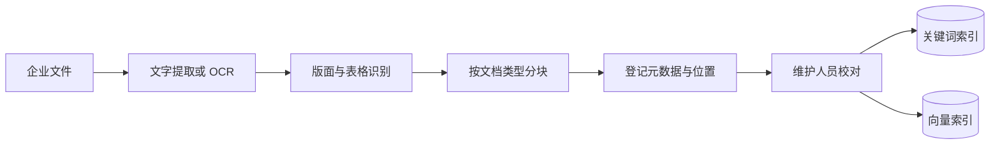

> **当前演示**：段落在 `src/data/knowledge.ts` 中人工维护，每段带稳定编号、章节和示例页码；文字提取、OCR、版面分析和索引均未实现。

检索与回答的上限由入库决定。一份 PDF 要先变成可定位、可检索、可核对的段落，并带上版本、生效状态和访问范围，后面的每一层才有依据可用。

## 怎么设计

1. **按文档类型分块**：制度按「章 › 节 › 条」切分，一条一块；操作指引按步骤或小节切分；问答类按问答对切分；标准表按行切分。
2. **每块登记元数据**：文件、版本、生效日期、负责部门、文件层级、访问范围、页码与坐标、标题路径。
3. **分块前补充上下文**：为每块加上标题路径和一句来源说明，例如「《差旅管理办法》第四章 · 第十二条 公务改签」。
4. **维护人员校对解析结果**：入库后可以查看和修正分块，重点检查扫描件、跨页表格和被拆开的条款。
5. **登记文件之间的引用**：识别「以相关制度为准」「按《××》执行」等表述，建立文件之间的链接。
6. **新版本发布即更新索引**：旧版本的分块退出默认检索，但保留下来，查询历史规定时可以指定版本。

## 为什么这样设计

### 1. 按文档类型分块

按固定长度切分可能把一条规定拆成两半：前一块写「可以申请报销」，后一块写「并取得直属负责人的书面确认」。检索只命中前一块时，回答就会漏掉条件。制度本身按条文组织，按条切分能让条件和例外留在同一块里。RAGFlow 的 Laws 模板按条文结构切分，Table 模板以表格行为单位，都是这个思路。

### 2. 每块登记元数据

后面每一层都依赖这些字段：检索按访问范围和生效状态过滤，冲突时按文件层级取舍，引用显示版本和页码，原文面板按坐标高亮。这些信息必须在入库时由确定性的代码登记，不能留给模型在回答时推断。

### 3. 分块前补充上下文

单看「合理改签费用，可以申请报销」，不知道它属于哪份制度、适用于谁。Anthropic 的 Contextual Retrieval 实验中，为每块补充上下文说明后，检索失败率下降 49%，再加上重排后下降 67%。Onyx 也提供类似的选项，但文档提醒它会显著增加嵌入计算的成本。

### 4. 维护人员校对解析结果

OCR 错字、跨页表格断裂、印章遮挡都会让检索失效，而且很难在回答阶段发现。RAGFlow 提供分块可视化与人工干预；把人放在入库环节，一次修正对之后所有问题都生效。

### 5. 登记文件之间的引用

《报销材料清单》写着「具体材料和适用条件以相关制度为准」。如果知道它指向哪份制度，检索命中清单时就能顺着链接补查上位制度。这相当于把 PaperQA2 沿论文引用扩展来源的做法，改造为沿制度引用扩展。

### 6. 新版本发布即更新索引

《制度发布与版本管理规范》要求「制度更新后，由负责部门撤下过期版本并保留变更记录」。索引遵循同样的规则：旧版本不参与默认检索，新旧条款就不会同时出现在候选中；需要查询历史规定时，再显式指定版本。

## 当前演示

| 设计 | 当前演示 |
| --- | --- |
| 按条分块 | 人工按条款整理段落，例如「第四章 · 第十二条 公务改签」 |
| 元数据 | 记录文件编号、版本、更新日期、所属知识库、章节和示例页码；没有生效状态、访问范围和坐标 |
| 文字提取、OCR、索引与校对界面 | 未实现；原文面板展示已知段落，不是真实的 PDF 阅读器 |
| 文件之间的引用 | 未实现；改签场景由预设的查找过程体现「优先引用制度原文」 |

## 参考

- [RAGFlow](https://github.com/infiniflow/ragflow)、[数据集配置与分块模板](https://github.com/infiniflow/ragflow/blob/main/docs/guides/dataset/configuration.md)
- [Contextual Retrieval](https://www.anthropic.com/news/contextual-retrieval)（Anthropic）
- [Search Settings](https://docs.onyx.app/admins/advanced_configs/search_configs)（Onyx）
