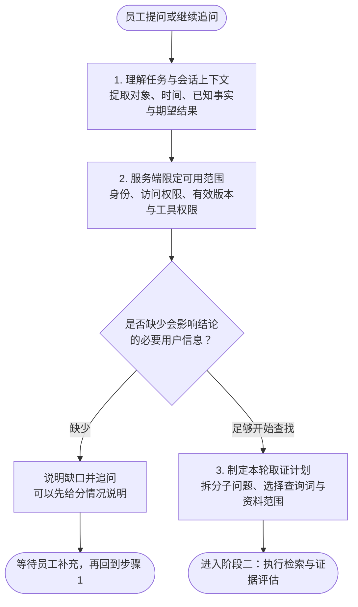
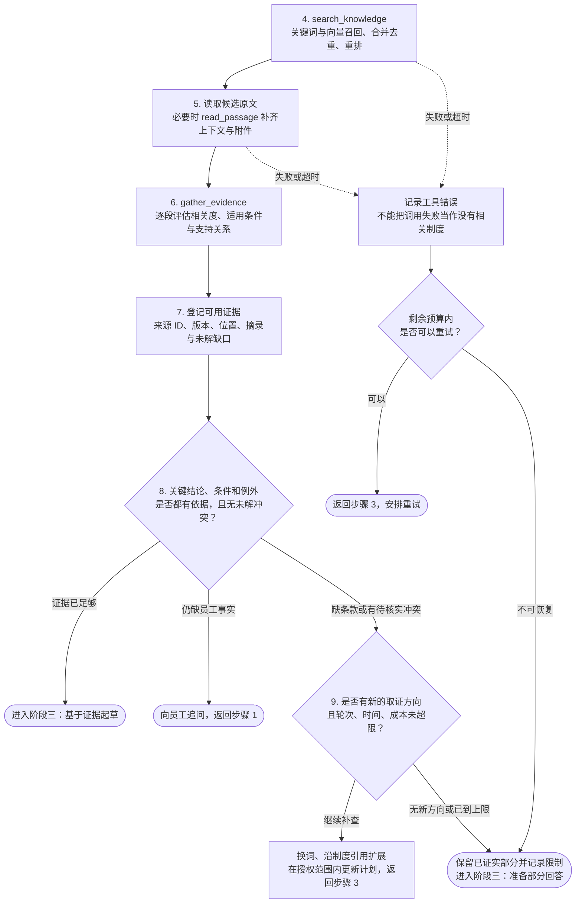
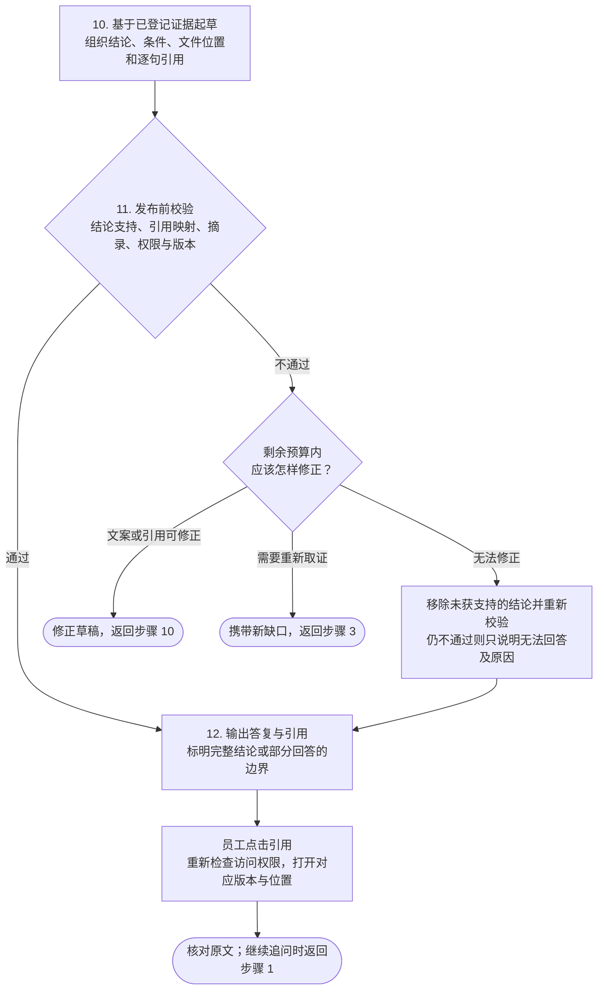
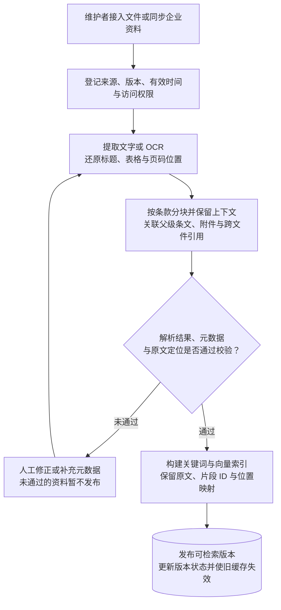

> **当前演示**：当前是三步引导式前端演示；查找过程按预设场景回放，不连接模型、检索服务或企业系统。企业、文件与条款均为虚构示例。

企业知识助手面向需要按制度办事的员工，例如报销、请假、采购和文件外发。员工要的不是一段流畅的回答，而是三件事：**能不能做、要满足什么条件、依据在哪里**。

讲解按设计时的决策顺序组织：先拆解员工在问什么，再确定「准确优先于速度」这条主线；带着这个标准选取四个开源项目的做法；然后分入库、检索、引用、权限四层说明方案；最后说明如何评估 Agent 的质量与边界。每章先用编号列出「怎么设计」，再按相同编号解释「为什么这样设计」，章末列出参考资料。

## 怎么设计

### 完整流程：资料准备 → Agent 取证 → 回答核对

一张“检索 → 回答”的图省略了最关键的部分：**Agent 每一轮拿到了什么、还缺什么、为什么继续查或决定停下**。完整方案分为两条链路：资料维护者先准备可检索的知识；员工提问后，Agent 在权限和预算约束内反复取证，再生成、校验并展示答复。

以下流程图是**目标系统设计**。当前前端只回放其中的预设问答，真实入库、检索、模型决策和服务端校验尚未接入。图中编号用于与后文逐步对照，不能理解为每个问题都必须执行固定次数的步骤。

### 员工提问之后：一次 Agent 查询的完整闭环

先看运行时流程。为保持字号和分支清晰，下图分成三个相互衔接的阶段；“返回步骤”仍回到同一次运行，沿用已有证据和剩余预算。每张图默认完整显示，点击“全屏查看”可缩放和平移以核对细节。找文件和查规定使用同一取证流程，可以同时返回文件位置与附引用的解释，不强制二选一，也不自动跳转到首页的知识库浏览区。

**阶段一 · 理解问题，确定能查什么（步骤 1–3）**

**阶段二 · 调工具、读原文、判断是否需要继续（步骤 4–9）**

补查不是把原问题再搜一遍：先从证据记录中找到未覆盖的条件，再选择新的查询词、相关制度或附件。候选分数高也可能不适用；**相关度达标只是初筛，步骤 8 才判断这些证据能否共同支撑答复**。

**阶段三 · 组织答复，校验后交给员工核对（步骤 10–12）**

**所有“返回步骤”共享同一份运行状态和预算**：重试、补查、改写都计入上限，不会因为回到上一步就重新计时。员工点击停止时，中断本次生成并取消尚未完成的工具请求，不把未完成过程标成成功。

### 每一步是谁在做，留下什么

| 步骤 | 主要责任 | 留下的结果 |
| --- | --- | --- |
| 1 · 理解任务 | 模型辅助理解，运行框架提供会话上下文 | 本次要回答的子问题、已知事实、待确认条件；不把旧对话里的猜测当作事实 |
| 2 · 限定范围 | 服务端执行身份、权限、版本与工具检查 | 本轮允许读取的资料范围；模型只能在此范围内提出查询 |
| 3 · 取证计划 | Agent 根据目标和现有缺口选择下一步 | 本轮子问题、查询词、工具与停止条件 |
| 4–5 · 检索与阅读 | 检索服务返回候选，工具按 ID 读取原文 | 有来源的候选段落及上下文；权限过滤覆盖检索、缓存与原文读取 |
| 6 · 评估候选 | 模型辅助判断，框架校验返回结构与来源 | 相关度、采用或排除理由，以及对具体结论的支持、反驳或不确定关系 |
| 7 · 证据状态 | 框架维护跨轮次的证据记录 | 已采用来源、已经覆盖的条件、未解缺口；补查在此基础上增加信息 |
| 8–9 · 决定下一步 | Agent 判断缺口，框架强制执行预算 | 继续查、追问、给部分回答或结束；不是候选一达到分数就直接回答 |
| 10–11 · 起草与校验 | 模型组织答复，系统检查引用与权限，支持关系另做语义校验 | 只使用已登记证据的答复草稿；失败时改写、补查或删除无依据结论 |
| 12 · 展示与核对 | 服务端输出答复，界面呈现来源，原文服务再次鉴权 | 可读答复、句子旁的引用、可定位的原文，以及明确的结束状态 |

Agent 的核心是 **“计划 → 调工具 → 观察结果 → 更新证据 → 决定下一步”** 这个循环。模型负责理解与判断；搜索、读取、编号映射、权限和预算由系统执行。对用户展示的是每轮目标、动作、评分和结果摘要，不要求暴露模型完整的内部推理。

### 用“改签费能否报销”走一遍

| 运行阶段 | 当前掌握的信息 | 下一步为什么这样选 |
| --- | --- | --- |
| 理解问题 | 不知道员工是因公还是因私改签 | 先查两类规则，给分情况说明；若要判断某一笔费用，再向员工确认原因和审批事实 |
| 第 1 轮检索 | 查询“出差 改签费 报销”，先看差旅与报销资料 | 找到直接规定费用承担方式的条款 |
| 第 1 轮筛选 | 公务改签与个人改签条款各 9 分；适用范围 4 分、通用审批流程 3 分 | 前两段采用，后两段排除；评分仅说明相关度，还要核对版本和适用条件 |
| 缺口判断 | 费用承担有依据，但材料与提交时限尚未覆盖 | 新一轮只补材料和时限，不把已解决的问题从头重查 |
| 第 2 轮取证 | 换查“改签 报销材料 提交时限”，读申请材料与报销操作条款 | 补齐行程凭证、书面确认、时限与申请关联规则 |
| 起草与核对 | 采用的 5 段证据形成 6 处句子引用 | 分情况回答，再列材料与时限；每个编号映射到同一份原文中的具体句子 |
| 员工继续追问 | “我是个人原因改签，也能报吗？” | 使用新增事实重新判断适用条款，不直接沿用上一轮的概括性结论 |

上表的两轮查询、分数和 6 处引用来自当前预设演示；自主决定是否补查、真实会话条件理解和发布前语义校验仍属于目标设计。

### 主流程之外，也必须有明确出口

| 情况 | 系统应怎样结束或恢复 |
| --- | --- |
| 个人余额、实时状态等业务数据 | 已接入且获授权时调用只读业务工具，保留查询时间；本产品未接入时说明无法查询并指向对应系统，不能从制度文本推算 |
| 无检索结果或无权访问 | 说明当前可用范围内未找到依据，不泄露无权查看的文件名、命中数或内容 |
| 工具报错、网络中断 | 在剩余预算内有限重试；仍失败则注明查找未完成，不把工具失败写成“制度没有规定” |
| 来源失效、规定冲突 | 有明确有效性规则时重新取证；无法消除冲突时呈现来源和差异，交由制度负责人核实 |
| 只有摘录位置匹配失败 | 来源有效且支持关系已确认时可退到段落级定位，并说明定位精度；来源或结论无效则不能只删除引用继续输出 |
| 达到预算或员工停止 | 停止发起新动作；按已验证内容给部分结果或明确停止状态，不无限重试、不伪造完成 |

### 提问之前：资料怎样成为可用证据

这是文件新增或更新时执行的后台流程，不需要每次提问重做。

入库交付的是“**原文 + 可检索片段 + 来源与权限 + 原文位置**”。为检索补充的摘要和上下文另外保存，不能冒充原文被引用。详细的解析、分块和版本策略见「资料入库」。

### 讲解目录

| 章节 | 回答的问题 |
| --- | --- |
| 场景拆解 | 员工到底在问什么，每类问题需要什么 |
| 准确性优先 | 为什么准确优先于速度，代价是什么 |
| 参考项目 | 四个开源项目各取什么、不取什么 |
| 资料入库 | 文件怎样变成可以定位的证据 |
| 检索与补查 | Agent 怎么查、什么时候停 |
| 引用与核对 | 怎样让每个结论回到原文句子 |
| 权限与边界 | 哪些资料不能看，哪些问题不该答 |
| 评估与观测 | 怎样证明回答是准的 |

整体遵循五条原则：

1. **准确优先于速度**：只在有继续取证价值时补查；关键信息不足时追问，无法证实时说明限制。
2. **证据先于回答**：先登记可核实的证据，再检查其是否支持具体结论；相关度分数不能代替这一判断。
3. **条件是答案的一部分**：结论与适用条件、例外和需要确认的信息一起给出。
4. **边界由系统强制执行**：访问范围、版本选择和引用映射由系统执行，不只依赖提示词。
5. **用可见的过程换取等待**：每轮写明在查什么、采用或排除了什么，随时可以停止。

## 为什么这样设计

### 1. 准确优先于速度

员工会照着回答去行动：提交报销、发送文件、安排休假。答错的代价由员工和公司承担，可能是报销被退回，也可能是违规外发；慢一点的代价是多等十几秒。员工拿来比较的也不是搜索引擎，而是自己翻制度或询问财务、人事同事。具体分析见「准确性优先」。

### 2. 证据先于回答

如果先生成回答、再给回答找出处，模型容易为已经写好的结论配上一个看似相关的来源。先确定证据，再在证据范围内作答，每个引用编号都能对应到具体文件版本和段落。引用能定位并不等于结论成立，还要检查适用对象、条件和例外。

### 3. 条件是答案的一部分

在本项目的虚构制度中，「改签费可以报销」缺少关键限定：公务原因可以申请，个人原因自行承担，而且需要负责人书面确认。制度问题的结论几乎都带条件；省略了条件，员工按字面去办就会出错。

### 4. 边界由系统强制执行

提示词只能降低模型越界的概率，不能保证它不越界。员工能看哪些资料、哪一版制度现行有效、引用编号指向哪一段，都应依据权威元数据和访问规则执行；元数据缺失时应暂停使用或要求核实，不能让模型补猜。

### 5. 用可见的过程换取等待

准确优先意味着更多检索和阅读，回答会更慢。把每轮的目标、命中的文件和筛选理由展示出来，员工知道系统在做什么；发现方向不对时，也可以提前停止并换个问法。

## 参考

- [Language agents achieve superhuman synthesis of scientific knowledge](https://arxiv.org/abs/2409.13740)（PaperQA2 论文）
- [Building effective agents](https://www.anthropic.com/engineering/building-effective-agents)（Anthropic）
