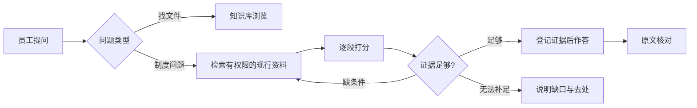

> **当前演示**：前端交互完整可用；查找过程按预设场景回放，不连接模型、检索服务或企业系统。企业、文件与条款均为虚构示例。

企业知识助手面向需要按制度办事的员工，例如报销、请假、采购和文件外发。员工要的不是一段流畅的回答，而是三件事：**能不能做、要满足什么条件、依据在哪里**。

讲解按设计时的决策顺序组织：先拆解员工在问什么，再确定「准确优先于速度」这条主线；带着这个标准选取四个开源项目的做法；然后分入库、检索、引用、权限四层说明方案；最后说明如何评估，以及当前实现到哪一步。每章先用编号列出「怎么设计」，再按相同编号解释「为什么这样设计」，章末列出参考资料。

## 怎么设计

| 章节 | 回答的问题 |
| --- | --- |
| 场景拆解 | 员工到底在问什么，每类问题需要什么 |
| 准确性优先 | 为什么准确优先于速度，代价是什么 |
| 参考项目 | 四个开源项目各取什么、不取什么 |
| 资料入库 | 文件怎样变成可以定位的证据 |
| 检索与补查 | Agent 怎么查、什么时候停 |
| 引用与核对 | 怎样让每个结论回到原文句子 |
| 权限与边界 | 哪些资料不能看，哪些问题不该答 |
| 评估与观测 | 怎样证明回答是准的 |
| 实现与取舍 | 当前演示做到哪一步 |

整体遵循五条原则：

1. **准确优先于速度**：宁可多查一轮、宁可说「资料不足」，也不给没有依据的确定答案。
2. **证据先于回答**：先登记通过筛选的证据，回答只能引用登记过的内容。
3. **条件是答案的一部分**：结论与适用条件、例外和需要确认的信息一起给出。
4. **边界写在代码里**：权限、版本和引用映射由系统执行，不依赖提示词。
5. **用可见的过程换取等待**：每轮写明在查什么、采用或排除了什么，随时可以停止。

## 为什么这样设计

### 1. 准确优先于速度

员工会照着回答去行动：提交报销、发送文件、安排休假。答错的代价由员工和公司承担，可能是报销被退回，也可能是违规外发；慢一点的代价是多等十几秒。员工拿来比较的也不是搜索引擎，而是自己翻制度或询问财务、人事同事。具体分析见「准确性优先」。

### 2. 证据先于回答

如果先生成回答、再给回答找出处，模型容易为已经写好的结论配上一个看似相关的来源。先确定证据，再在证据范围内作答，每个引用编号都能对应到具体文件版本和段落。

### 3. 条件是答案的一部分

「改签费可以报销」只说对了一半：公务原因可以，个人原因不行，而且需要负责人书面确认。制度问题的结论几乎都带条件；省略了条件，员工按字面去办就会出错。

### 4. 边界写在代码里

提示词只能降低模型越界的概率，不能保证它不越界。员工能看哪些资料、哪一版制度现行有效、引用编号指向哪一段，都应由确定性的代码决定，结果可预期，也可审计。

### 5. 用可见的过程换取等待

准确优先意味着更多检索和阅读，回答会更慢。把每轮的目标、命中的文件和筛选理由展示出来，员工知道系统在做什么；发现方向不对时，也可以提前停止并换个问法。

## 当前实现与设计的对应

| 设计 | 当前演示 |
| --- | --- |
| 检索、逐段打分、补查 | 按预设场景回放：思考、`search_knowledge` 与 `gather_evidence` 两个工具调用，必要时补查一轮 |
| 证据阈值，资料不足时不下结论 | 已实现：低于 5 分的段落标为排除，回答只引用通过阈值的证据 |
| 引用到句子并在原文中高亮 | 已实现：悬停预览原文句子，点击后在原文面板高亮 |
| 过程可见、随时停止 | 已实现：查找过程按轮次展示，可以随时停止 |
| 资料入库、混合检索、模型调用 | 未实现：段落数据人工维护，场景按关键词匹配 |
| 权限过滤、版本管理、分级查找、评估体系 | 设计方案 |

## 参考

- [Language agents achieve superhuman synthesis of scientific knowledge](https://arxiv.org/abs/2409.13740)（PaperQA2 论文）
- [Building effective agents](https://www.anthropic.com/engineering/building-effective-agents)（Anthropic）
