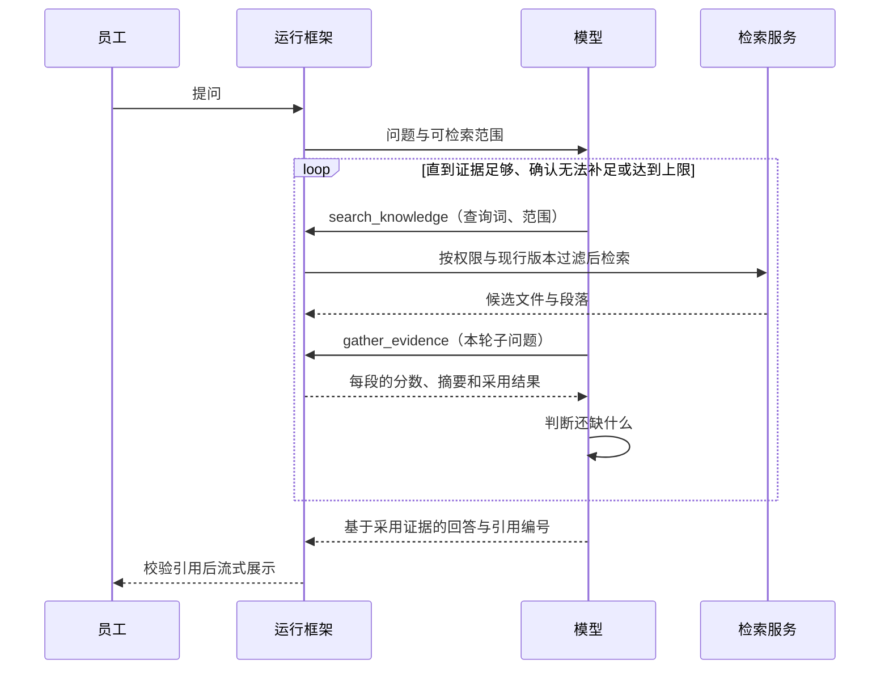

> **当前演示**：每个预设场景的查找过程已经写好，由本地适配器按顺序回放为思考、工具调用和回答；不调用模型或检索服务。

Agent 的工作是把一个问题变成一组足以支持结论的证据。本章说明工具如何划分、一轮查找做什么、什么时候补查、什么时候停止。

## 怎么设计

| 工具 | 输入 | 输出 | 说明 |
| --- | --- | --- | --- |
| `search_knowledge` | 查询词、知识库范围 | 命中文件与候选段落（标题、版本、位置） | 混合检索加重排；权限与版本过滤在服务端执行 |
| `gather_evidence` | 本轮要回答的子问题 | 每个候选的 0–10 分、一句话摘要、是否采用 | 逐段阅读打分，低于阈值的不采用 |
| `read_passage`（设计） | 段落编号 | 段落全文与相邻段落 | 需要上下文时按需读取 |

1. **单一主循环**：一个 Agent 完成拆解、检索、判断和作答；轮次与时长有上限。
2. **检索与判断分开**：`search_knowledge` 只负责找候选，`gather_evidence` 负责判断候选是否回答了问题。
3. **混合检索加重排**：关键词检索匹配条款用语、编号和金额，向量检索匹配说法不同的表达，合并后再重排。
4. **逐段打分，阈值筛选**：每个候选按本轮子问题打 0–10 分，并写一句理由；低于阈值的不进入回答。
5. **按缺口补查**：每轮结束时写明已经确认什么、还缺什么；补查时换用新的查询词，或扩大范围。
6. **明确的停止条件**：每个子问题都有证据支持时作答；补查后仍没有相关证据时说明缺口；达到上限时汇报进展。
7. **回答只基于采用的证据**：先给结论，再分情况说明条件，然后列出材料或步骤，最后是需要员工确认的信息。

## 为什么这样设计

### 1. 单一主循环

制度问题通常是「找到几条条款、判断是否足够、组织回答」的短链路，每一步都依赖前一步读到的内容。Anthropic 建议从最简单的方案开始，只在能证明收益时增加复杂度。多 Agent 并行检索适合资料多、可以拆成独立方向的研究任务；对单个制度问题收益有限，还会成倍增加 token 消耗。

### 2. 检索与判断分开

检索返回的是「提到了这些词」的段落，不代表这些段落回答了问题。改签场景第一轮检索命中了《差旅管理办法》的适用范围一节，它包含「差旅」「出差」等词，却没有涉及改签，只得到 4 分，被排除。把判断做成独立的工具，筛选理由就能逐条展示和检查。

### 3. 混合检索加重排

员工的问法和制度用语经常不一致：员工问「能发到私人邮箱吗」，制度写的是「文件外发」「个人网盘」，向量检索能匹配这类近义表达；「第十二条」「30 个自然日」这类精确信息，则是关键词检索更可靠。四个参考项目都采用混合检索加重排，这是目前的常规组合，不是本项目的差异点。

### 4. 逐段打分，阈值筛选

PaperQA2 的消融实验表明，逐段阅读并打分显著提高了准确率。每段附一句理由，员工和维护人员都能看出为什么用了这段、为什么没用那段。阈值 5 分是演示设定，真实系统需要在评测集上校准：阈值太低会混入无关段落，太高会漏掉有用的条件。

### 5. 按缺口补查

第一轮常常只回答了一半。改签场景第一轮确认了「公务原因可以报销、个人原因自行承担」，但还不知道要准备哪些材料、什么时候提交；第二轮换用「改签 报销材料 提交时限」检索，并把根目录的通用文件纳入范围。补查由缺口驱动，不是固定查两轮，所以简单问题不会被拖慢。

### 6. 明确的停止条件

对未覆盖的问题，第一轮候选只得了 2 分和 1 分；换一个更宽的说法补查后，仍只有一个 1 分的候选。这时继续查找只会浪费时间，Agent 停下来说明找不到依据，不生成结论。没有上限的循环可能反复换词、迟迟不收尾；到达上限时汇报进展，比静默超时更可控。

### 7. 回答只基于采用的证据

回答阶段只能看到通过阈值的证据，引用编号只能取自证据登记表。这样每个结论都有可以追溯的来源；资料中没有的内容，模型也没有材料可以发挥。结构上先给结论，最后列出需要员工确认的信息，例如「还需要确认你的改签原因和审批情况」。

## 当前演示如何工作

`src/lib/research.ts` 为每个场景写好查找过程：思考、`search_knowledge`、`gather_evidence`，必要时补查，最后是带 `[[n]]` 引用标记的回答。`planResearch` 按关键词选择场景；没有匹配的问题，走「两轮检索仍然不足」的兜底流程。

`src/lib/knowledge-adapter.ts` 实现 assistant-ui 的 `ChatModelAdapter`，按接近真实的节奏把查找过程输出为消息片段：思考文本逐字出现；工具调用先显示参数，等待后再填入结果；`gather_evidence` 的结果按分数排序，并标出是否采用。同一轮的片段共享轮次编号，界面据此按轮显示目标和摘要，例如「3 份文件，保留 3 段证据」。`AbortSignal` 可以随时中断查找。

| 演示中看到的 | 对应设计 |
| --- | --- |
| 每轮先写明要查的问题 | 按缺口补查（5） |
| 检索词、范围和命中文件 | 检索与判断分开（2）、混合检索（3） |
| 候选段落的分数、摘要、采用或排除 | 逐段打分与阈值（4） |
| 依据充分或依据不足的结束状态 | 停止条件（6） |
| 回答正文与下方的引用文档 | 回答只基于采用的证据（7） |

## 参考

- [Building effective agents](https://www.anthropic.com/engineering/building-effective-agents)（Anthropic）
- [How we built our multi-agent research system](https://www.anthropic.com/engineering/multi-agent-research-system)（Anthropic）
- [PaperQA2 论文](https://arxiv.org/html/2409.13740v2)
