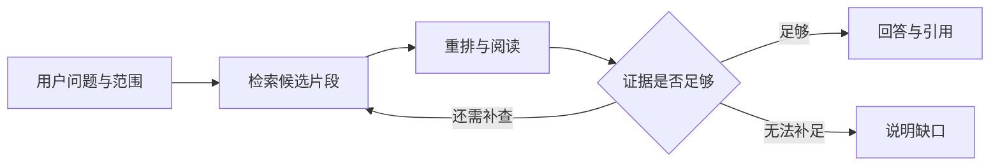

## 检索与补查

一个完整的检索问答 Agent，不只是把问题和资料塞进提示词。它还需要调用搜索工具、收集证据、判断缺口，并决定何时继续查找、何时结束。

### 搜索与阅读分开

关键词检索擅长文件名称、条款用语和准确编号；语义检索帮助发现表达不同但相关的片段。重排再次比较候选内容与问题，减少把“提到了同一个词”误当作“回答了这个问题”。这几步都不能单独保证结论正确。

### 四个项目的分工与重叠

| 参考项目 | 重点启发 | 不是它自动保证的事情 |
| --- | --- | --- |
| [RAGFlow](https://github.com/infiniflow/ragflow) | 文档到检索片段的工程链路 | 解析始终正确、答案必然可信 |
| [PaperQA2](https://github.com/Future-House/paper-qa) | 搜索、收集证据、生成回答的研究循环 | 任意企业文档都能直接适配 |
| [Onyx](https://github.com/onyx-dot-app/onyx) | 企业搜索、上下文组织和来源关联 | 有引用就代表每个结论有充分支持 |
| [Kotaemon](https://github.com/Cinnamon/kotaemon) | 问答与原文阅读的完整体验 | 高亮位置一定准确、文档版本始终有效 |

它们有重叠，属于可比较的方案，不需要同时把四套系统接进产品。

### 当前演示如何工作

`src/lib/research.ts` 为每个预设场景写好一次完整的查找过程；`src/lib/knowledge-adapter.ts` 把它按时间顺序输出为 assistant-ui 的消息片段：思考文本、两个工具调用（`search_knowledge` 检索、`gather_evidence` 收集证据）及其结果，最后是带引用的回答。没有向搜索服务、向量数据库或模型发送请求，界面上的查找过程标注「模拟」。

| 演示中看到的 | 参考的做法 |
| --- | --- |
| 先说明要查什么，再检索；证据不够时写明缺什么并补查一轮 | PaperQA2 的搜索、收集证据、生成回答循环 |
| 每个候选段落写一句摘要、打 0–10 分，低于 5 分的排除 | PaperQA2 的证据打分与相关度阈值 |
| 状态行「资料 · 相关 · 证据」随每一步更新 | PaperQA2 每次工具调用后返回的状态 |
| 每轮先写明要查的问题，再列出查询词、检索范围和命中文件；进行中展开，下一轮开始时收成一行结果 | Onyx 的搜索时间线 |
| 结束时标注依据充分或不足；全部低于阈值时提示相关度低 | PaperQA2 的确定/不确定结束，Kotaemon 的低相关度提醒 |

改签问题会经过两轮：第一轮确认改签原因决定能否报销，第二轮补查材料和时限。未覆盖的问题两轮候选都低于阈值，直接说明找不到依据，不生成结论。
