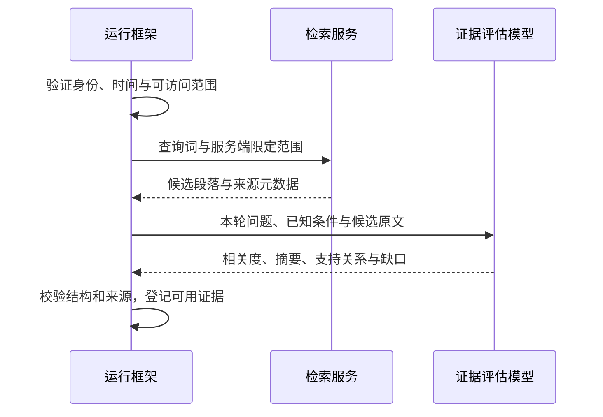

Agent 的工作是把一个问题变成一组足以支持结论的证据。本章说明工具如何划分、一轮查找做什么、什么时候补查、什么时候停止。

## 怎么设计

### 一轮取证的职责（目标设计）

以下展示条件明确后的一轮检索与证据评估。外层是否再查、追问或结束，由下表中的缺口类型决定；评分由模型评估，运行框架负责校验和执行边界。

| 本轮结果 | 后续动作 |
| --- | --- |
| 仍缺相关条款或例外 | 有新的查询方向且未达上限时补查；扩大范围仍不能越过权限与时间边界 |
| 缺员工个人事实或问题含义不明确 | 追问必要条件，或先给分情况说明；不能靠重复检索补出个人事实 |
| 存在未解决冲突 | 呈现冲突和来源，要求业务负责人确认，不自行挑选有利条款 |
| 证据覆盖结论及关键条件 | 用已登记证据生成候选答复，检查支持关系和引用后展示 |
| 无有效资料、无新方向或达到预算上限 | 说明已知内容、缺口与可行去处；未获支持的部分不下结论 |

| 工具 | 输入 | 输出 | 说明 |
| --- | --- | --- | --- |
| `search_knowledge` | 查询词、知识库范围 | 命中文件与候选段落（标题、版本、位置） | 混合检索加重排；权限与版本过滤在服务端执行 |
| `gather_evidence` | 本轮子问题、候选段落与已知条件 | 相关度、证据摘要、支持或反驳的条件、未解决缺口 | 模型辅助评估；框架检查来源与结构，分数仅用于筛选 |
| `read_passage`（设计） | 段落编号 | 段落全文与相邻段落 | 需要上下文时按需读取 |

1. **单一主循环**：一个 Agent 完成拆解、检索、判断和作答；轮次与时长有上限。
2. **检索与判断分开**：`search_knowledge` 只负责找候选，`gather_evidence` 负责判断候选是否回答了问题。
3. **混合检索加重排**：关键词检索匹配条款用语、编号和金额，向量检索匹配说法不同的表达，合并后再重排。
4. **打分后还要检查证据覆盖**：相关度用于排序和初筛；再核对适用对象、时效、条件、例外与冲突，不能只按分数决定能否回答。
5. **按缺口选择动作**：缺资料才补查，缺个人事实就追问；补查用新的查询方向，范围始终受服务端权限与时间约束。
6. **明确的停止条件**：证据支持关键结论和条件时作答；无法补足或达到上限时给出已证实部分与限制；等待员工补充时暂停本轮。
7. **回答只基于采用的证据**：先给结论，再分情况说明条件，然后列出材料或步骤，最后是需要员工确认的信息。

## 为什么这样设计

### 1. 单一主循环

制度问题通常是「找到几条条款、判断是否足够、组织回答」的短链路，每一步都依赖前一步读到的内容。Anthropic 建议从最简单的方案开始，只在能证明收益时增加复杂度。多 Agent 并行检索适合资料多、可以拆成独立方向的研究任务；对单个制度问题收益有限，还会成倍增加 token 消耗。

### 2. 检索与判断分开

检索返回的是「提到了这些词」的段落，不代表这些段落回答了问题。改签场景第一轮检索命中了《差旅管理办法》的适用范围一节，它包含「差旅」「出差」等词，却没有涉及改签，只得到 4 分，被排除。把判断做成独立的工具，筛选理由就能逐条展示和检查。

### 3. 混合检索加重排

员工的问法和制度用语经常不一致：员工问「能发到私人邮箱吗」，制度写的是「文件外发」「个人网盘」，向量检索能匹配这类近义表达；「第十二条」「30 个自然日」这类精确信息，则是关键词检索更可靠。本项目把关键词与向量混合检索作为待验证方案。各参考项目的检索管线不同，例如 PaperQA2 论文描述的是论文搜索、段落向量召回和模型重排摘要，不能把四者统称为同一套混合检索实现。

### 4. 打分后还要检查证据覆盖

PaperQA2 的消融实验表明，逐段阅读并打分显著提高了准确率。每段附一句理由，员工和维护人员都能看出为什么用了这段、为什么没用那段。阈值 5 分是演示设定，真实系统需要在评测集上校准。高分段落也可能已经失效、只适用于其他员工，或被另一条款限定；因此还需要检查来源有效性、条件覆盖和相互冲突。

### 5. 按缺口选择动作

第一轮常常只回答了一半。改签场景第一轮确认了「公务原因可以报销、个人原因自行承担」，但还不知道要准备哪些材料、什么时候提交；第二轮换用「改签 报销材料 提交时限」检索，并把根目录的通用文件纳入范围。这是脚本演示的一种资料缺口。若缺的是员工因何改签、是否获批，系统应追问事实或给条件化答复，而不是再检索一遍制度。真实系统根据缺口决定动作，演示轮数不能当作在线决策能力。

### 6. 明确的停止条件

对未覆盖的问题，第一轮候选只得了 2 分和 1 分；换一个更宽的说法补查后，仍只有一个 1 分的候选。这时继续查找只会浪费时间，Agent 停下来说明找不到依据，不生成结论。没有上限的循环可能反复换词、迟迟不收尾；到达上限时汇报进展，比静默超时更可控。

### 7. 回答只基于采用的证据

回答阶段只能看到通过阈值的证据，引用编号只能取自证据登记表。这样每个结论都有可以追溯的来源；这能缩小生成范围，但不能阻止模型误读或补写未获支持的内容；还需逐项检查候选答复是否得到证据支持，不能通过就改写、删去相应断言或说明限制。结构上先给结论，再分情况说明适用条件；改签原因和书面确认等要求放在对应结论中，不在末尾重复提醒。

## 怎样让员工看懂查找过程

每轮先说明要解决的子问题，再展示检索词、资料范围、命中文件和筛选结果。补查时要指出上一轮还缺什么，结束时说明证据是否足够。员工据此判断方向是否正确，也能随时停止。

展示的是查找目标、工具动作和结果摘要，不是模型完整的内部推理。原文留在引用入口中按需核对，避免大段资料淹没查找过程。

| 员工看到的 | 对应设计 |
| --- | --- |
| 每轮先写明要查的问题 | 按缺口补查（5） |
| 检索词、范围和命中文件 | 检索与判断分开（2）、混合检索（3） |
| 候选段落的分数、摘要、采用或排除 | 相关度筛选（4），覆盖检查另行验证 |
| 查找完成或中断的过程状态；不足时在回答中说明限制 | 停止条件（6） |
| 回答正文与句子旁的引用标记 | 回答只基于采用的证据（7） |

## 参考

- [Building effective agents](https://www.anthropic.com/engineering/building-effective-agents)（Anthropic）
- [How we built our multi-agent research system](https://www.anthropic.com/engineering/multi-agent-research-system)（Anthropic）
- [PaperQA2 论文](https://arxiv.org/html/2409.13740v2)
